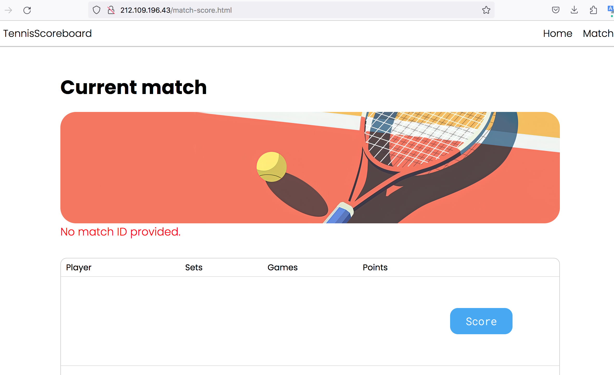

```text
Знаком ❗️ помечены критически важные замечания, а также места нарушения ТЗ.
```

## В целом по проекту

- Имена пакетов в java пишут в единственном числе. Когда смотришь на набор классов в пакете, кажется естественным использовать множественное число, обобщая то, что в нём находится, но если посмотреть на декларацию пакета в классе и сравнить варианты, например: `*.validation.limits.annotations.MaxLength` и `*.validation.limit.annotation.MaxLength`, то логика названия в единственном числе становится более понятной, так как это отображает полное имя одного (каждого) конкретного класса.

Если имя пакета состоит из двух слов, то они пишутся слитно строчными буквами: 'gameState' —> 'gamestate'.

- ❗️Сейчас HTML страницы находятся в `src/main/webapp/`. Это корневая директория веб-приложения, и любая страница в нём доступна по прямому URL.

Например, сейчас можно открыть http://212.109.196.43/match-score.html и увидеть пустую страницу, предназначенную для текущего матча, котора должна быть доступна только при определённых условиях (когда матч создан).



View (страницы HTML) не должен быть доступен в обход Controller (сервлета), поэтому стоит поместить все HTML страницы внутрь `WEB-INF`.

- Местами в классах не хватает форматирования. Перед `git commit` можно нажимать (`cmd + alt + l` в Idea на mac os). Это работает как для текущего класса, так и для всего пакета: если выделить пакет и нажать комбинацию клавиш, то исправление форматирования будет выполнено для всех классов в этом пакете.

- В некоторых классах есть неиспользуемые импорты. Перед `git commit` можно нажимать (`ctrl + alt + o` в Idea на mac os). Это работает как для текущего класса, так и для всего пакета: если выделить пакет и нажать комбинацию клавиш, то оптимизация импорта будет выполнена для всех классов в этом пакете.

- Нет шаблона для hibernate.properties. Можно коммитить шаблон файла (application.properties.example), который будет содержать только названия всех необходимых переменных, но без их реальных значений.

- ❗️В проекте есть Spring, но используются не все его преимущества. 

Например, JPA-репозитории, а также возможность автоматической трансляции исключений работы с БД.

Стоит перевести приложение на Spring-ориентированный подход и использовать подходящие преимущества этого фреймворка.

- По поводу названий переменных, методов и классов можно советоваться с нейронками. А также по поводу сообщений в исключениях.

- Где-то числительные, обозначающие игроков, написаны цифрами (player1, player2), а где-то словами (firstPlayer, secondPlayer) — лучше выбрать один подход и во всём приложении использовать его.

