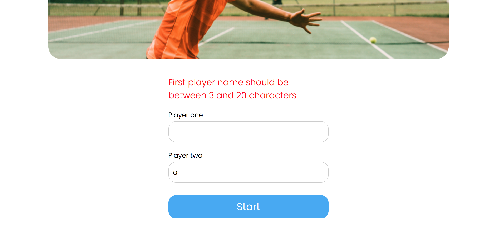
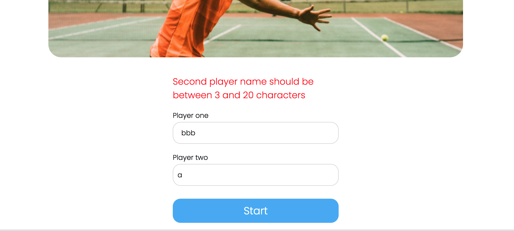
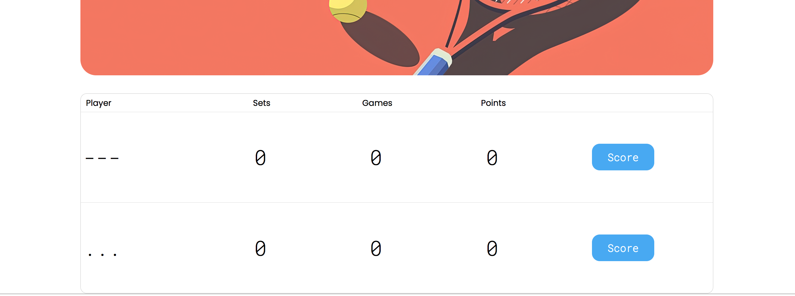
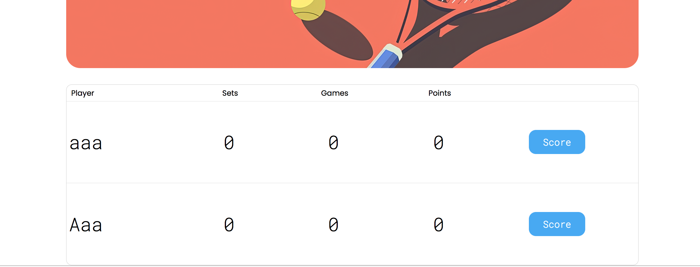
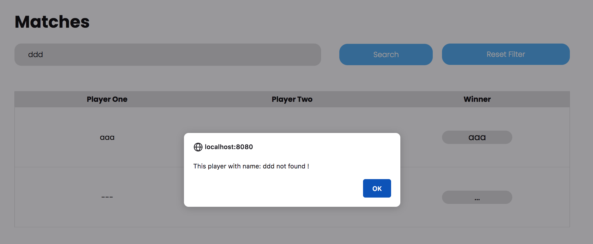
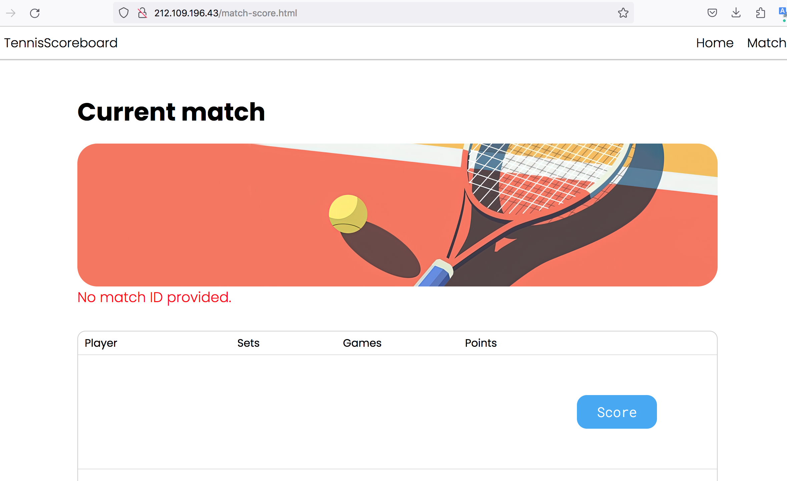

# Сводный отчёт по код-ревью проекта `tennis-scoreboard`

# Review на реализацию от [@fynkoR](https://github.com/fynkoR/tennis-scoreboard) проекта [Табло теннисного матча](https://zhukovsd.github.io/java-backend-learning-course/projects/tennis-scoreboard/)

> Ревью выполнено в формате fork-а репозитория и добавления комментариев 'In-Situ' и обучающих заметок в формате markdown.

К классам и файлам конфигурации добавлены подробные комментарии. 

Там же есть ссылки на файлы, объясняющие некоторые особо значимые темы. 

Сами файлы с заметками находятся в одном пакете с классами, к которым относится тема заметки.

```
В `TODO`-комментариях️ описаны критически важные замечания, а также места нарушения ТЗ.
```

Список всех `TODO`-комментариев сгруппированных по пакетам и классам можно посмотреть в Idea через меню: `View` -> `Tool Windows` -> `TODO`

Читать стоит в таком порядке:

1. В файле `1-functional-overview.md` описан функциональный обзор приложения.

2. В файле `2-refactoring-roadmap.md` находится план работы над исправлениями.

- В файле `Common.md` описаны замечания, относящиеся ко всему проекту или нескольким его частям. (можно читать в любое время)

- В файле `Pluses.md` описаны наиболее значимые плюсы. (можно читать в любое время)

- В файле `Conclusion.md` находится заключение. (можно читать в любое время)

```text
Знаком ❗️ помечены критически важные замечания, а также места нарушения ТЗ.
```

## Функциональный обзор

- Сообщения об ошибке валидации имени сейчас отображаются по очереди:






Это ухудшает пользовательский опыт. Лучше сразу отображать все сообщения, чтобы пользователь мог исправить всё разом.

- Сейчас можно создать игроков с такими именами:



Раз в проекте есть валидация, стоит добавить проверку, что в имени есть буквы и ввести другие уместные ограничения.

- ❗️Можно создать игроков с одинаковыми именами, если написать их в разном регистре:



Имя игрока должно быть уникальным без учёта регистра.

- Если поиск по имени не дал результатов, лучше показывать пустой список матчей, а не ошибку:



- Последний сыгранный матч отображается последним в списке на странице завершённых матчей — чтобы посмотреть его результат в таблице надо листать до последней страницы. Лучше, чтобы последний завершённый отображался первым в списке (на первой странице).

## Конфигурационные файлы

### pom.xml

Файл конфигурации удобнее читать, когда зависимости в нём расположены в порядке важности для проекта. Как и из кода, комментарии из файлов конфигурации стоит удалять перед коммитом.
```xml
  <!-- Файл конфигурации удобнее читать, когда зависимости в нём расположены в порядке важности для проекта -->
  <!--Как и из кода, комментарии из файлов конфигурации стоит удалять перед коммитом.-->
  <!-- Alpha и milestone версии программного обеспечения являются предварительными выпусками.
        Лучше использовать стабильные (GA - General Availability) версии зависимостей. -->
  <dependencies>
```
***

Alpha и milestone версии программного обеспечения являются предварительными выпусками. Лучше использовать стабильные (GA - General Availability) версии зависимостей.
```xml
  <!-- Alpha и milestone версии программного обеспечения являются предварительными выпусками.
        Лучше использовать стабильные (GA - General Availability) версии зависимостей. -->
  <dependencies>
```
***

## pet.project.configs

### DispatcherServletInitializer

В проекте нет ни одного не-GET/POST эндпоинта, поэтому HiddenHttpMethodFilter не нужен.
```java
    // В проекте нет ни одного не-GET/POST эндпоинта, поэтому HiddenHttpMethodFilter не нужен.
    private void registerHiddenFieldFilter(ServletContext servletContext) {
        servletContext.addFilter("hiddenHttpMethodFilter",
                new HiddenHttpMethodFilter()).addMappingForUrlPatterns(null, true, "/*");
    }
```
***

### WebConfig

В веб конфигурации лучше оставить сканирование пакетов только веб слоя, а остальные сканировать в другом классе (например в AppConfig).
```java
 @ComponentScan("pet.project") // В веб конфигурации лучше оставить
    // сканирование пакетов только веб слоя, а остальные сканировать в другом классе (например в AppConfig).
```
***

@PropertySource с абсолютным путём — это хрупкий подход. Конфиг сломается например при другой версии Tomcat.
```java
 @PropertySource("file:/var/lib/tomcat10/conf/hibernate.properties") // @PropertySource с абсолютным путём — это хрупкий подход.
    // Конфиг сломается например при другой версии Tomcat.
```
***

Неиспользуемый в приложении код стоит удалять перед коммитом.
```java
//@PropertySource("classpath:hibernate.properties") // Неиспользуемый в приложении код стоит удалять перед коммитом.
```
***

Класс собрал в себя настройки вообще всего приложения. Это нарушает принцип Единой ответственности (SRP). Можно разнести настройки на разные классы, соответствующие слоям приложения: общие настройки приложения, веб настройки, настройки, связанные с работой с БД (persistence).
```java
    // Класс собрал в себя настройки вообще всего приложения. Это нарушает принцип Единой ответственности (SRP).
        // Можно разнести настройки на разные классы, соответствующие слоям приложения:
        // - общие настройки приложения
        // - веб настройки
        // - настройки, связанные с работой с БД (persistence)
```
***

Везде, где есть возможность, лучше внедрять зависимости через аргументы метода, а не через обращение к методу создания бина. То есть вместо этого:
```java
        @Bean
        public LocalSessionFactoryBean sessionFactory() {
            // ...
            sessionFactory.setDataSource(dataSource());
            // ...
        }
```
Лучше так:
```java
        @Bean
        public LocalSessionFactoryBean sessionFactory(DataSource dataSource) {
            // ...
            sessionFactory.setDataSource(dataSource);
            // ...
        }
```
***

Если конструктор единственный в классе, то @Autowired над ним можно не писать.
```java
    // Если конструктор единственный в классе, то @Autowired над ним можно не писать
    @Autowired
    public WebConfig(Environment environment) {
        this.environment = environment;
    }
```
***

В Hibernate 6+ диалект определяется автоматически, поэтому явное указание не обязательно. Для PostgreSQL диалект подхватится сам.
```java
        // В Hibernate 6+ диалект определяется автоматически, поэтому явное указание не обязательно.
            // Для PostgreSQL диалект подхватится сам.
        properties.put("hibernate.dialect", environment.getRequiredProperty("hibernate.dialect"));
```
***

## pet.project.controllers

### MatchController

Для REST контроллера есть специальная аннотация @RestController.
```java
 @Controller // Для REST контроллера есть специальная аннотация @RestController
 @RequestMapping("/matches")
 public class MatchController {
```
***

Если конструктор единственный в классе, то @Autowired над ним можно не писать.
```java
    // Если конструктор единственный в классе, то @Autowired над ним можно не писать
    @Autowired
    public MatchController(MatchService matchService) {
        this.matchService = matchService;
    }
```
***

Вместо ручной установки Location лучше построить путь к созданному ресурсу с учётом контекста (например, через MvcUriComponentsBuilder). Так путь всегда будет корректным, даже если приложение развёрнуто не в корне.
```java
        // Вместо ручной установки Location лучше построить путь к созданному ресурсу с учётом контекста
            // (например, через MvcUriComponentsBuilder).
            // Так путь всегда будет корректным, даже если приложение развёрнуто не в корне.
        return ResponseEntity
                .status(HttpStatus.CREATED)
                .header("Location", "/matches/" + uuid)
                .body(new CreateMatchResponse(uuid));
```
***

Нет валидации @RequestBody AddPointRequest. Без неё при некорректном DTO вместо ошибки 400, клиент получит 500 от исключения позже.
```java
    // TODO: Нет валидации @RequestBody AddPointRequest.
        // Без неё при некорректном DTO вместо ошибки 400, клиент получит 500 от исключения позже.
    @PostMapping("/{uuid}/point")
    public ResponseEntity<MatchDto> addPoint(@RequestBody AddPointRequest addPointRequest, @PathVariable("uuid") UUID uuid){
```
***

CurrentPage уже устанавливается в сервисе и не должна перетираться здесь другим значением. Это создаёт несогласованность: 0-based в сервисе vs 1-based в контроллере.
```java
        // TODO: CurrentPage уже устанавливается в сервисе и не должна перетираться здесь другим значением.
            // Это создаёт несогласованность: 0-based в сервисе vs 1-based в контроллере.
        listFinishedMatchDto.setCurrentPage(page);
        return ResponseEntity.ok(listFinishedMatchDto);
```
***

## pet.project.dao

### MatchDao

Для DAO можно использовать специальную стереотипную аннотацию — @Repository.
```java
 @Component // Для DAO можно использовать специальную стереотипную аннотацию — @Repository
 public class MatchDao {
```
***

Нет интерфейса для этого класса. Это нарушение Принципа инверсии зависимостей (Dependency Inversion Principle): Принцип гласит, что модули верхних уровней не должны зависеть от модулей нижних уровней, а также они должны зависеть от абстракций. В данном случае вышестоящие модули (сервисы) напрямую зависят от конкретных реализаций репозиториев, что делает систему жёстко связанной. В небольших проектах это не критично, но в крупных — предпочтительно использовать интерфейсы.
```java
    // Нет интерфейса для этого класса.
        // Это нарушение Принципа инверсии зависимостей (Dependency Inversion Principle):
        // Принцип гласит, что модули верхних уровней не должны зависеть от модулей нижних уровней,
        // а также они должны зависеть от абстракций. В данном случае вышестоящие модули (сервисы)
        // напрямую зависят от конкретных реализаций репозиториев, что делает систему жёстко связанной.
        // В небольших проектах это не критично, но в крупных — предпочтительно использовать интерфейсы.
```
***

Слой репозиториев должен перехватывать специфичные для технологии исключения и оборачивать их в свои исключения слоя доступа к данным. Это скрывает детали реализации от верхних слоёв и делает их независимыми от деталей реализации репозиториев. Тело каждого метода стоит обернуть в try-catch и отлавливать исключения при работе с БД. Либо добавить механизм автоматической трансляции исключений. Например, это можно сделать создав бин PersistenceExceptionTranslationPostProcessor. Тогда Spring будет сам оборачивать их в исключения из иерархии DataAccessException (например, DataIntegrityViolationException, JpaSystemException и др).
```java
    // TODO: Слой репозиториев должен перехватывать специфичные для технологии исключения
        // и оборачивать их в свои исключения слоя доступа к данным.
        // Это скрывает детали реализации от верхних слоёв и делает их независимыми от деталей реализации репозиториев.
        // Тело каждого метода стоит обернуть в try-catch и отлавливать исключения при работе с БД.
        // Либо добавить механизм автоматической трансляции исключений.
        // Например, это можно сделать создав бин PersistenceExceptionTranslationPostProcessor.
        // Тогда Spring будет сам оборачивать их в исключения из иерархии DataAccessException
        // (например, DataIntegrityViolationException, JpaSystemException и др).
```
***

Как и в PlayerDao, методы в этом классе тоже можно написать в текучем (fluent) стиле.
```java
    // Как и в PlayerDao, методы в этом классе тоже можно написать в текучем (fluent) стиле.
```
***

Константы в Java принято объявлять первыми (самыми верхними) в классе.
```java
    // Константы в Java принято объявлять первыми (самыми верхними) в классе
```
***

В HQL запросах используется ORDER BY m.id ASC. При таком подходе последний сыгранный матч окажется последним в списке и пользователю придётся листать до последней страницы, чтобы найти его в списке завершённых матчей. Лучше использовать сортировку по убыванию — `ORDER BY m.id DESC`. Это улучшит пользовательский опыт.
```java
    // В HQL запросах используется ORDER BY m.id ASC.
        // При таком подходе последний сыгранный матч окажется последним в списке и
        // пользователю придётся листать до последней страницы, чтобы найти его в списке завершённых матчей.
        // Лучше использовать сортировку по убыванию — `ORDER BY m.id DESC`.
        // Это улучшит пользовательский опыт.
```
***

Для HQL-констант используется префикс SQL. Лучше использовать HQL или JPQL.
```java
    // Для HQL-констант используется префикс SQL. Лучше использовать HQL или JPQL.
```
***

Если конструктор единственный в классе, то @Autowired над ним можно не писать.
```java
    // Если конструктор единственный в классе, то @Autowired над ним можно не писать
    @Autowired
    public MatchDao(SessionFactory sessionFactory) {
        this.sessionFactory = sessionFactory;
    }
```
***

Можно просто countAll.
```java
    // Можно просто countAll
    public Long countByFindFinishedMatches(){
```
***

Можно просто countAllByPlayerName.
```java
    // Можно просто countAllByPlayerName
    public Long countByFindFinishedMatchesByPlayerName(String playerName){
```
***

### PlayerDao

Для DAO можно использовать специальную стереотипную аннотацию — @Repository.
```java
 @Component // Для DAO можно использовать специальную стереотипную аннотацию — @Repository
 public class PlayerDao {
```
***

Нет интерфейса для этого класса. Это нарушение Принципа инверсии зависимостей (Dependency Inversion Principle): Принцип гласит, что модули верхних уровней не должны зависеть от модулей нижних уровней, а также они должны зависеть от абстракций. В данном случае вышестоящие модули (сервисы) напрямую зависят от конкретных реализаций репозиториев, что делает систему жёстко связанной. В небольших проектах это не критично, но в крупных — предпочтительно использовать интерфейсы.
```java
    // Нет интерфейса для этого класса.
        // Это нарушение Принципа инверсии зависимостей (Dependency Inversion Principle):
        // Принцип гласит, что модули верхних уровней не должны зависеть от модулей нижних уровней,
        // а также они должны зависеть от абстракций. В данном случае вышестоящие модули (сервисы)
        // напрямую зависят от конкретных реализаций репозиториев, что делает систему жёстко связанной.
        // В небольших проектах это не критично, но в крупных — предпочтительно использовать интерфейсы.
```
***

Лучше выносить тексты HQL запросов в `private static final` константы и давать им понятные имена.
```java
    // Лучше выносить тексты HQL запросов в `private static final` константы и давать им понятные имена.
```
***

Ключевые слова в тексте одного из HQL-запросов написаны в нижнем регистре. Хотя это и не влияет на работоспособность, написание ключевых слов SQL/HQL в верхнем регистре (`UPPERCASE`) является общепринятым стандартом. Это значительно улучшает читаемость запросов, так как визуально отделяет синтаксические конструкции языка от имён сущностей и полей.
```java
    // Ключевые слова в тексте одного из HQL-запросов написаны в нижнем регистре.
        // Хотя это и не влияет на работоспособность, написание ключевых слов SQL/HQL
        // в верхнем регистре (`UPPERCASE`) является общепринятым стандартом.
        // Это значительно улучшает читаемость запросов, так как визуально отделяет
        // синтаксические конструкции языка от имён сущностей и полей.
```
***

Текст HQL запроса удобнее читать, когда он логично разбит на строки, даже если он короткий. Для визуального разделения запросов на строки лучше использовать текстовые блоки.
```java
    // Текст HQL запроса удобнее читать, когда он логично разбит на строки, даже если он короткий.
        // Для визуального разделения запросов на строки лучше использовать текстовые блоки.
```
***

Слой репозиториев должен перехватывать специфичные для технологии исключения и оборачивать их в свои исключения слоя доступа к данным. Это скрывает детали реализации от верхних слоёв и делает их независимыми от деталей реализации репозиториев. Тело каждого метода стоит обернуть в try-catch и отлавливать исключения при работе с БД. Либо добавить механизм автоматической трансляции исключений. Например, это можно сделать создав бин PersistenceExceptionTranslationPostProcessor. Тогда Spring будет сам оборачивать их в исключения из иерархии DataAccessException (например, DataIntegrityViolationException, JpaSystemException и др).
```java
    // TODO: Слой репозиториев должен перехватывать специфичные для технологии исключения
        // и оборачивать их в свои исключения слоя доступа к данным.
        // Это скрывает детали реализации от верхних слоёв и делает их независимыми от деталей реализации репозиториев.
        // Тело каждого метода стоит обернуть в try-catch и отлавливать исключения при работе с БД.
        // Либо добавить механизм автоматической трансляции исключений.
        // Например, это можно сделать создав бин PersistenceExceptionTranslationPostProcessor.
        // Тогда Spring будет сам оборачивать их в исключения из иерархии DataAccessException
        // (например, DataIntegrityViolationException, JpaSystemException и др).
```
***

Если конструктор единственный в классе, то @Autowired над ним можно не писать.
```java
    // Если конструктор единственный в классе, то @Autowired над ним можно не писать
    @Autowired
    public PlayerDao(SessionFactory sessionFactory) {
        this.sessionFactory = sessionFactory;
    }
```
***

В текущей сигнатуре метод подразумевает возврат абсолютно всех сущностей из таблицы базы данных одним запросом. Это опасный подход с точки зрения производительности и потребления памяти. Если таблица вырастет до значительных размеров (тысячи или миллионы записей), вызов этого метода почти гарантированно приведёт к деградации производительности. Загрузка огромного объёма данных из БД будет чрезвычайно медленной, создавая колоссальную нагрузку и на приложение, и на сервер БД. Что в конечном итоге вызовет `OutOfMemoryError` — попытка загрузить все записи в память приложения приведёт к переполнению кучи (heap). Метод должен принимать параметры `offset` (смещение) и `limit` (количество записей на странице).
```java
    // TODO: В текущей сигнатуре метод подразумевает возврат абсолютно всех сущностей из таблицы базы данных одним запросом.
        // Это опасный подход с точки зрения производительности и потребления памяти.
        // Если таблица вырастет до значительных размеров (тысячи или миллионы записей), вызов этого метода
        // почти гарантированно приведёт к деградации производительности. Загрузка огромного объёма данных из БД
        // будет чрезвычайно медленной, создавая колоссальную нагрузку и на приложение, и на сервер БД.
        // Что в конечном итоге вызовет `OutOfMemoryError` — попытка загрузить все записи в память приложения приведёт к переполнению кучи (heap).
        // Метод должен принимать параметры `offset` (смещение) и `limit` (количество записей на странице).
    public List<Player> findAll(){
```
***

## pet.project.dto

### AddPointRequest

Этот класс можно сделать record-ом.
```java
    // Этот класс можно сделать record-ом
```
***

Нет аннотаций валидации над этим полем.
```java
    // Нет аннотаций валидации над этим полем
    private String name;
```
***

### CreateMatchRequest

Этот класс можно сделать record-ом. Это значительно сократит шаблонный код.
```java
    // Этот класс можно сделать record-ом. Это значительно сократит шаблонный код.
```
***

### CreateMatchResponse

Этот класс можно сделать record-ом. Это значительно сократит шаблонный код.
```java
    // Этот класс можно сделать record-ом. Это значительно сократит шаблонный код.
```
***

### ErrorResponse

Этот класс можно сделать record-ом. Это значительно сократит шаблонный код.
```java
    // Этот класс можно сделать record-ом. Это значительно сократит шаблонный код.
```
***

### FinishedMatchDto

Этот класс можно сделать record-ом. Это значительно сократит шаблонный код.
```java
    // Этот класс можно сделать record-ом. Это значительно сократит шаблонный код.
```
***

В объектах DTO лучше не иметь сеттеров без крайней необходимости (которой в этом проекте нет), чтобы не было возможности забыть установить одно из полей.
```java
    // В объектах DTO лучше не иметь сеттеров без крайней необходимости (которой в этом проекте нет),
        // чтобы не было возможности забыть установить одно из полей.
```
***

### ListFinishedMatchDto

Этот класс можно сделать record-ом. Это значительно сократит шаблонный код.
```java
    // Этот класс можно сделать record-ом. Это значительно сократит шаблонный код.
```
***

В объектах DTO лучше не иметь сеттеров без крайней необходимости (которой в этом проекте нет), чтобы не было возможности забыть установить одно из полей.
```java
    // В объектах DTO лучше не иметь сеттеров без крайней необходимости (которой в этом проекте нет),
        // чтобы не было возможности забыть установить одно из полей.
```
***

### MatchDto

Этот класс можно сделать record-ом. Это значительно сократит шаблонный код.
```java
    // Этот класс можно сделать record-ом. Это значительно сократит шаблонный код.
```
***

В объектах DTO лучше не иметь сеттеров без крайней необходимости (которой в этом проекте нет), чтобы не было возможности забыть установить одно из полей.
```java
    // В объектах DTO лучше не иметь сеттеров без крайней необходимости (которой в этом проекте нет),
        // чтобы не было возможности забыть установить одно из полей.
```
***

### PlayerDto

Этот класс можно сделать record-ом. Это значительно сократит шаблонный код.
```java
    // Этот класс можно сделать record-ом. Это значительно сократит шаблонный код.
```
***

Точнее было бы назвать PlayerScoreDto.
```java
    // Точнее было бы назвать PlayerScoreDto
```
***

В объектах DTO лучше не иметь сеттеров без крайней необходимости (которой в этом проекте нет), чтобы не было возможности забыть установить одно из полей.
```java
    // В объектах DTO лучше не иметь сеттеров без крайней необходимости (которой в этом проекте нет),
        // чтобы не было возможности забыть установить одно из полей.
```
***

## pet.project.entities

### sql-keywords.md
### Использование зарезервированных слов в качестве названий в БД

Использование зарезервированного слова (например, `USER`, `ORDER`, `GROUP`) в качестве названия таблицы в базе данных — это плохая практика, которая может привести к ряду проблем.

Вот основные из них:

### 1. Синтаксические ошибки

Это самая главная и частая проблема. SQL-парсер видит зарезервированное слово и ожидает определённой синтаксической конструкции, а не названия таблицы.

**Пример:**
При попытке получить все записи из таблицы с названием `ORDER`.
```sql
SELECT * FROM ORDER;
```
этот запрос, скорее всего, вызовет ошибку, потому что `ORDER` — это ключевое слово для `ORDER BY` (сортировка). Парсер будет ожидать после него `BY` и не поймёт, что `ORDER` — это название таблицы.

### 2. Необходимость экранирования (Quoting)

Чтобы обойти синтаксические ошибки, придётся постоянно заключать название таблицы в специальные кавычки, которые зависят от конкретной СУБД:

* **MySQL / MariaDB:** обратные кавычки (`` ` ``)
    ```sql
    SELECT * FROM `ORDER`;
    ```
* **PostgreSQL / Стандарт SQL:** двойные кавычки (`" "`)
    ```sql
    SELECT * FROM "ORDER";
    ```
* **SQL Server:** квадратные скобки (`[ ]`)
    ```sql
    SELECT * FROM [ORDER];
    ```

### 3. Снижение читаемости и усложнение кода

Из-за необходимости постоянного экранирования код становится менее читаемым. Разработчики могут легко забыть поставить кавычки, что приведёт к ошибкам, на поиск которых уйдёт время.

### 4. Проблемы с ORM и другими инструментами

Инструменты, которые автоматически генерируют SQL-запросы (например, Hibernate, JPA, SQLAlchemy и другие ORM), а также различные GUI-клиенты и утилиты для миграции, могут не справиться с такими названиями. Они могут не знать, что `ORDER` нужно экранировать, и будут генерировать нерабочий SQL-код. Это потребует дополнительной конфигурации или ручного вмешательства.

### 5. Потеря переносимости

Ключевые слова могут отличаться в разных СУБД. Слово, которое не зарезервировано в одной системе, может быть зарезервировано в другой. Если команда сменит СУБД, проект с такими названиями таблиц потребует значительной доработки.

---

**Лучшая практика:**

**Никогда не использовать зарезервированные слова для названий таблиц, столбцов и других объектов в БД.**

Всегда проверять список зарезервированных слов для основных СУБД. Чтобы избежать случайных совпадений, можно придерживаться соглашений об именовании, например:
* Использовать префиксы: `tbl_order`.
* Использовать множественное число (если слово во множественном числе не зарезервировано): `orders` (слово `orders` не зарезервировано).
* Добавлять суффиксы: `order_data`.

### Matches

"Matches" является зарезервированным словом в некоторых СУБД. Здесь проблем не будет, но лучше не выбирать такие названия. (см. файл "sql-keywords.md" в этом же пакете).
```java
 @Table(name = "Matches") // "Matches" является зарезервированным словом в некоторых СУБД.
    // Здесь проблем не будет, но лучше не выбирать такие названия. (см. файл "sql-keywords.md" в этом же пакете)
 public class Matches{
```
***

Стоит добавить проверки, что игроки разные и победитель один из игроков. Например, через аннотацию org.hibernate.annotations.Check над классом.
```java
    // Стоит добавить проверки, что игроки разные и победитель один из игроков. Например, через аннотацию org.hibernate.annotations.Check над классом.
```
***

Для поля `id` лучше использовать обёртку `Integer`, вместо примитивного типа `int`. `Integer` (обёртка) может быть `null` и для нового объекта поле `id` будет `null` до тех пор, пока Hibernate не присвоит ему значение после сохранения. А `int` (примитив) не может быть `null` и для нового, ещё не сохраненного объекта, поле `id` будет иметь значение по умолчанию `0`. Использование обертки `Integer` является предпочтительным для генерируемых ID, потому что позволяет легко и надёжно определить, является ли сущность новой, просто проверив `if (id == null)`. С использованием примитива `0` может оказаться валидным значением ID (хотя и редко), что создаст путаницу.
```java
    // Для поля `id` лучше использовать обёртку `Integer`, вместо примитивного типа `int`.
        // `Integer` (обёртка) может быть `null` и для нового объекта поле `id` будет `null` до тех пор, пока Hibernate не присвоит ему значение после сохранения.
        // А `int` (примитив) не может быть `null` и для нового, ещё не сохраненного объекта, поле `id` будет иметь значение по умолчанию `0`.
        // Использование обертки `Integer` является предпочтительным для генерируемых ID, потому что позволяет легко и надёжно определить,
        // является ли сущность новой, просто проверив `if (id == null)`.
        // С использованием примитива `0` может оказаться валидным значением ID (хотя и редко), что создаст путаницу.
```
***

Связи `@ManyToOne` не имеют явного указания о стратегии загрузки. По умолчанию для `@ManyToOne` используется `FetchType.EAGER`, что приводит к немедленной загрузке связанных сущностей при загрузке `Match`. Это может вызывать проблемы производительности (N+1 запросов) и излишнюю загрузку данных, особенно если связанные объекты не всегда нужны.
```java
    // Связи `@ManyToOne` не имеют явного указания о стратегии загрузки.
        // По умолчанию для `@ManyToOne` используется `FetchType.EAGER`, что приводит к немедленной загрузке связанных сущностей при загрузке `Match`.
        // Это может вызывать проблемы производительности (N+1 запросов) и излишнюю загрузку данных, особенно если связанные объекты не всегда нужны.
```
***

Сеттеры не нужны — позволяют создать объект с установленным id или изменить состав игроков после создания (например сделать постороннего игрока победителем).
```java
    // TODO: сеттеры не нужны — позволяют создать объект с установленным id или изменить состав игроков после создания
        // (например сделать постороннего игрока победителем).
```
***

Спецификация JPA требует наличия конструктора без аргументов для создания экземпляров сущностей, однако ему не обязательно быть `public`. Когда конструктор публичный, он становится частью общедоступного API класса. Это позволяет использовать его для создания "пустых", невалидных объектов (без установки обязательных полей) в любом месте приложения, хотя он предназначен исключительно для внутреннего использования фреймворком (JPA). Хорошим подходом будет ограничить область видимости этого конструктора до `protected`. Это делает его недоступным для прямого вызова из других пакетов, но оставляет видимым для JPA и дочерних классов.
```java
    // Спецификация JPA требует наличия конструктора без аргументов для создания экземпляров сущностей,
        // однако ему не обязательно быть `public`. Когда конструктор публичный, он становится частью общедоступного API класса.
        // Это позволяет использовать его для создания "пустых", невалидных объектов (без установки обязательных полей)
        // в любом месте приложения, хотя он предназначен исключительно для внутреннего использования фреймворком (JPA).
        //
        // Хорошим подходом будет ограничить область видимости этого конструктора до `protected`.
        // Это делает его недоступным для прямого вызова из других пакетов, но оставляет видимым для JPA и дочерних классов.
    public Matches(){}
```
***

### Player

Таблицы обычно называют во множественном числе.
```java
 @Table(name = "Player") // Таблицы обычно называют во множественном числе
 public class Player{
```
***

Нет индекса по имени для БД (должен быть по ТЗ). Его можно задать или через @Column(unique = true) или через аннотацию над классом. Можно задать индекс через аннотацию, чтобы у него было понятное имя — @Table(name = "Player", indexes = @Index(...)).
```java
    // TODO: Нет индекса по имени для БД (должен быть по ТЗ).
        // Его можно задать или через @Column(unique = true) или через аннотацию над классом
        // Можно задать индекс через аннотацию, чтобы у него было понятное имя — @Table(name = "Player", indexes = @Index(...))
```
***

Для поля `id` лучше использовать обёртку `Integer`, вместо примитивного типа `int`. `Integer` (обёртка) может быть `null` и для нового объекта поле `id` будет `null` до тех пор, пока Hibernate не присвоит ему значение после сохранения. А `int` (примитив) не может быть `null` и для нового, ещё не сохраненного объекта, поле `id` будет иметь значение по умолчанию `0`. Использование обертки `Integer` является предпочтительным для генерируемых ID, потому что позволяет легко и надёжно определить, является ли сущность новой, просто проверив `if (id == null)`. С использованием примитива `0` может оказаться валидным значением ID (хотя и редко), что создаст путаницу.
```java
    // Для поля `id` лучше использовать обёртку `Integer`, вместо примитивного типа `int`.
        // `Integer` (обёртка) может быть `null` и для нового объекта поле `id` будет `null` до тех пор, пока Hibernate не присвоит ему значение после сохранения.
        // А `int` (примитив) не может быть `null` и для нового, ещё не сохраненного объекта, поле `id` будет иметь значение по умолчанию `0`.
        // Использование обертки `Integer` является предпочтительным для генерируемых ID, потому что позволяет легко и надёжно определить,
        // является ли сущность новой, просто проверив `if (id == null)`.
        // С использованием примитива `0` может оказаться валидным значением ID (хотя и редко), что создаст путаницу.
```
***

Сеттеры не нужны — позволяют создать объект с установленным id или изменить имя игрока после создания.
```java
    // TODO: сеттеры не нужны — позволяют создать объект с установленным id или изменить имя игрока после создания.
```
***

Аннотации валидации в классе entity могут работать не так, как ожидается (например, срабатывать в момент flush, а не save). К тому же валидация имён игроков уже выполняется на входе этих данных в приложение. Поэтому в этом классе достаточно задавать только ограничения, влияющие на DDL.
```java
    // Аннотации валидации в классе entity могут работать не так,
        // как ожидается (например, срабатывать в момент flush, а не save).
        // К тому же валидация имён игроков уже выполняется на входе этих данных в приложение.
        // Поэтому в этом классе достаточно задавать только ограничения, влияющие на DDL.
```
***

Стоит добавить nullable = false и length = 20.
```java
    @Column(name = "name") // Стоит добавить nullable = false и length = 20
    private String name;
```
***

Спецификация JPA требует наличия конструктора без аргументов для создания экземпляров сущностей, однако ему не обязательно быть `public`. Когда конструктор публичный, он становится частью общедоступного API класса. Это позволяет использовать его для создания "пустых", невалидных объектов (без установки обязательных полей) в любом месте приложения, хотя он предназначен исключительно для внутреннего использования фреймворком (JPA). Хорошим подходом будет ограничить область видимости этого конструктора до `protected`. Это делает его недоступным для прямого вызова из других пакетов, но оставляет видимым для JPA и дочерних классов.
```java
    // Спецификация JPA требует наличия конструктора без аргументов для создания экземпляров сущностей,
        // однако ему не обязательно быть `public`. Когда конструктор публичный, он становится частью общедоступного API класса.
        // Это позволяет использовать его для создания "пустых", невалидных объектов (без установки обязательных полей)
        // в любом месте приложения, хотя он предназначен исключительно для внутреннего использования фреймворком (JPA).
        //
        // Хорошим подходом будет ограничить область видимости этого конструктора до `protected`.
        // Это делает его недоступным для прямого вызова из других пакетов, но оставляет видимым для JPA и дочерних классов.
    public Player() {}
```
***

## pet.project.enums

### enums.md
## enums

- Группировка классов в пакет по их типу не добавляет коду читаемость. Оба класса в этом пакете относятся к слою доменных моделей. Поэтому можно перенести их в соответствующий пакет.

### PlayerPosition

Можно назвать PlayerSide или TennisSide.
```java
    // Можно назвать PlayerSide или TennisSide
```
***

### Point

Больше подошло бы название stringValue.
```java
    // Больше подошло бы название stringValue
    private String title;
```
***

## pet.project.exceptions

### GameIsAlreadyWinException

"Гейм уже выигран" — это суждение со стороны победителя, а исключению, которое выбрасывается при попытке добавить очко в завершённом гейме, больше подошло бы название GameAlreadyFinishedException.
```java
    // "Гейм уже выигран" — это суждение со стороны победителя,
        // а исключению, которое выбрасывается при попытке добавить очко в завершённом гейме,
        // больше подошло бы название GameAlreadyFinishedException.
```
***

### GlobalExceptionHandler

Для REST перехватчика есть специальная аннотация @RestControllerAdvice.
```java
 @ControllerAdvice // Для REST перехватчика есть специальная аннотация @RestControllerAdvice
 public class GlobalExceptionHandler {
```
***

Класс отправляет сообщение из исключения (`exception.getMessage()`) напрямую пользователю. Сообщения об ошибках из исключений могут содержать технические детали, которые не предназначены для конечного пользователя и могут представлять угрозу безопасности. Например, сообщение может быть `"No entity found for query 'SELECT ...'"` или `"Validation failed for field 'internalFieldName'"`, что раскрывает структуру БД или внутренние имена полей. Лучше никогда не отправлять необработанное сообщение из исключения на клиент. Вместо этого можно использовать заранее определённые, безопасные сообщения или коды ошибок. Само исключение при этом нужно логировать для разработчиков. Это повысит безопасность приложения и улучшит пользовательский опыт при возникновении ошибок. В этом проекте допустимо отправлять exception.getMessage() для ошибок валидации.
```java
    // TODO: Класс отправляет сообщение из исключения (`exception.getMessage()`) напрямую пользователю.
        // Сообщения об ошибках из исключений могут содержать технические детали, которые не предназначены
        // для конечного пользователя и могут представлять угрозу безопасности. Например, сообщение может быть
        // `"No entity found for query 'SELECT ...'"` или `"Validation failed for field 'internalFieldName'"`,
        // что раскрывает структуру БД или внутренние имена полей.
        //
        // Лучше никогда не отправлять необработанное сообщение из исключения на клиент.
        // Вместо этого можно использовать заранее определённые, безопасные сообщения или коды ошибок.
        // Само исключение при этом нужно логировать для разработчиков.
        //
        // Это повысит безопасность приложения и улучшит пользовательский опыт при возникновении ошибок.
        //
        // В этом проекте допустимо отправлять exception.getMessage() для ошибок валидации.
```
***

Набор обрабатываемых исключений неполный. Стоит добавить обработку и других возможных исключений, в том числе общий обработчик для всех непредвиденных ошибок (Exception), чтобы клиент никогда не получал stack trace.
```java
    // TODO: Набор обрабатываемых исключений неполный.
        // Стоит добавить обработку и других возможных исключений, в том числе общий обработчик
        // для всех непредвиденных ошибок (Exception), чтобы клиент никогда не получал stack trace.
```
***

Класс зависит от конкретной технологии персистентности (Hibernate). Стоит использовать специализированную трансляцию исключений, которую предоставляет Spring и перехватывать здесь именно его исключения.
```java
    // TODO: Класс зависит от конкретной технологии персистентности (Hibernate).
        // Стоит использовать специализированную трансляцию исключений, которую предоставляет Spring
        // и перехватывать здесь именно его исключения.
```
***

Можно возвращать все ошибки, а не только первую, чтобы пользователь сразу мог исправить все недочёты.
```java
                .get(0) // Можно возвращать все ошибки, а не только первую, чтобы пользователь сразу мог исправить все недочёты
                .getDefaultMessage();
```
***

### NextPointAfterAdvantageException

Само название исключения говорит о том, что оно выбрасывается только на Advantage, поэтому можно или не передавать Point в конструктор или переименовать класс в более универсальное название.
```java
    // Само название исключения говорит о том, что оно выбрасывается только на Advantage,
        // поэтому можно или не передавать Point в конструктор
        // или переименовать класс в более универсальное название.
```
***

Лишний знак + внутри строки.
```java
        super("No next score after +" + point); // Лишний знак + внутри строки
```
***

## pet.project.models

### pola.md
## Принцип наименьшего удивления (Principle of Least Astonishment, POLA)

**Система должна вести себя так, как от неё ожидает большинство пользователей (разработчиков), и не должна вызывать удивление или замешательство.**

Это означает, что API, класс, метод или даже однострочное выражение должны быть **интуитивно понятными** и **предсказуемыми** для другого разработчика.

### Ключевые аспекты принципа

- Следование общепринятым соглашениям и идиомам: Имена методов и классов должны точно отражать их поведение. Геттеры начинаются с `get`/`is`, сеттеры — с `set`. Классы — `CamelCase`, переменные — `camelCase`, константы — `UPPER_SNAKE_CASE`.

- Предсказуемость поведения: Поведение методов должно быть интуитивно понятным и соответствовать тому, что подразумевает их имя и сигнатура.

- Соблюдение контрактов методов:

  - Если метод называется `getSomething()`, он должен возвращать что-то, а не изменять состояние.

  - Если метод называется `calculateSomething(params)`, он должен вычислять и возвращать результат, а не изменять переданные параметры.

- Следование единому стилю: Если в одном методе используется порядок параметров `(source, destination)`, то его следует придерживаться во всех похожих методах. Нельзя в другом методе делать `(destination, source)`.

- Согласованные возвращаемые значения: Если семейство методов возвращает `-1` при ошибке, не стоит в одном из них возвращать `0` или бросать исключение без веской причины.

Принцип наименьшего удивления в программировании — это о снижении когнитивной нагрузки на других разработчиков. Это создание кода, который ведёт себя так, как от него ждут, потому что он следует установленным правилам, здравому смыслу и согласованности. Следование этому принципу напрямую ведёт к созданию более чистого, поддерживаемого и надёжного кода.

### ssot-principle.md
## Принцип Единого источника истины (Single Source of Truth, SSOT)

Принцип Single Source of Truth (SSOT), или "Единый источник истины", в контексте программирования и управления данными означает архитектурный подход, при котором все данные о конкретной сущности или состоянии системы хранятся и управляются в одном единственном, авторитетном месте.

Суть принципа заключается в том, чтобы избежать дублирования информации и обеспечить ее согласованность. Если данные существуют в нескольких местах, всегда есть риск их расхождения, что приводит к ошибкам, путанице и неверным решениям.

#### Преимущества:

- Согласованность данных: невозможно иметь противоречивое состояние.
- Упрощение отладки и поддержки: данные берутся и изменяются только в одном месте.
- Упрощение тестирования: легче тестировать, так как состояние определяется одним источником.
- Повышение надежности: уменьшает количество ошибок и повышает уверенность в точности информации.

#### Возможные недостатки:
- Производительность: постоянное вычисление может быть дороже, чем хранение поля.
- Сложность вычислений: иногда вычисление сложное.

Следование принципу SSOT делает код более предсказуемым, надёжным и понятным.

### Game

Название поля вводит в заблуждение. Это поле служит флагом завершения гейма, а не победы первого игрока.
```java
    // TODO: Название поля вводит в заблуждение. Это поле служит флагом завершения гейма, а не победы первого игрока.
    private boolean firstPlayerWin;
```
***

Можно назвать аргумент winnerPosition.
```java
    public void addPointTo(PlayerPosition playerPosition){ // Можно назвать аргумент winnerPosition
```
***

Составные условия из if лучше выносить во вспомогательный метод с понятным названием.
```java
        // Составные условия из if лучше выносить во вспомогательный метод с понятным названием
        if(winnerPoints == Point.FORTY && (opponentPoints != Point.FORTY && opponentPoints != Point.ADVANTAGE)){
```
***

Если нет конфликта имён, можно обращаться к полям без this.
```java
        // Если нет конфликта имён, можно обращаться к полям без this.
        return this.firstPlayerWin;
```
***

Если нет конфликта имён, можно обращаться к полям без this.
```java
        // Если нет конфликта имён, можно обращаться к полям без this.
        return this.firstPlayerPoint;
```
***

Если нет конфликта имён, можно обращаться к полям без this.
```java
        // Если нет конфликта имён, можно обращаться к полям без this.
        return this.secondPlayerPoint;
```
***

### Match

Логику сопоставления имени игрока с его стороной можно вынести в отдельный класс (например, ActiveMatch), а в самом Match оставить только работу со счётом (по аналогии с классами для гейма-сета). Так соблюдение SRP станет более строгим.
```java
    // Логику сопоставления имени игрока с его стороной можно вынести в отдельный класс (например, ActiveMatch),
        // А в самом Match оставить только работу со счётом (по аналогии с классами для гейма-сета).
        // Так соблюдение SRP станет более строгим.
```
***

Объект сета отдаётся наружу для получения счёта в нём. Есть несколько подходов — или позволить мапперу получать все объекты моделей и напрямую запрашивать у них счёт, или в верхнем классе (ActiveMatch) создать все методы, возвращающие счёт на каждом этапе. Оба решения компромиссные. Третий вариант — создать классы, хранящие пары значений счёта и возвращать из верхнего уровня (ActiveMatch) их. Этот вариант тоже имеет свои минусы, но зато не отдаёт классы моделей за пределы их слоя.
```java
    // Объект сета отдаётся наружу для получения счёта в нём.
        // Есть несколько подходов — или позволить мапперу
        // получать все объекты моделей и напрямую запрашивать у них счёт,
        // или в верхнем классе (ActiveMatch) создать все методы, возвращающие счёт на каждом этапе.
        // Оба решения компромиссные.
        // Третий вариант — создать классы, хранящие пары значений счёта и возвращать из верхнего уровня (ActiveMatch) их.
        // Этот вариант тоже имеет свои минусы, но зато не отдаёт классы моделей за пределы их слоя.
```
***

Хранение поля boolean isMatchCompleted вынуждает следить не только за состоянием счёта, но и за этим полем. А Также это нарушает Принцип Единого источника истины (см. файл "ssot-principle.md" в этом же пакете). Источником истины в отношении состояния сета является счёт, а завершён ли он можно вычислять на лету — то есть иметь метод `boolean isFinished()`, а не поле.
```java
    // TODO: Хранение поля boolean isMatchCompleted вынуждает следить не только за состоянием счёта, но и за этим полем.
        // А Также это нарушает Принцип Единого источника истины (см. файл "ssot-principle.md" в этом же пакете).
        // Источником истины в отношении состояния сета является счёт, а завершён ли он можно вычислять на лету —
        // то есть иметь метод `boolean isFinished()`, а не поле.
    private boolean isMatchCompleted;
```
***

Это поле должно быть final, так как нельзя менять игроков после создания матча.
```java
    private TennisPlayer firstPlayer; // Это поле должно быть final, так как нельзя менять игроков после создания матча.
```
***

Это поле должно быть final, так как нельзя менять игроков после создания матча.
```java
    private TennisPlayer secondPlayer; // Это поле должно быть final, так как нельзя менять игроков после создания матча.
```
***

Вместо хранения одного поля лучше иметь коллекцию сетов и наполнять её по ходу игры. Это больше соответствовало бы реальному теннисному матчу. А также позволило бы не хранить счёт в отдельных переменных, а вычислять его на лету.
```java
    // Вместо хранения одного поля лучше иметь коллекцию сетов и наполнять её по ходу игры.
        // Это больше соответствовало бы реальному теннисному матчу.
        // А также позволило бы не хранить счёт в отдельных переменных, а вычислять его на лету.
    private Set set;
```
***

Константы в Java принято объявлять первыми (самыми верхними) в классе.
```java
    // Константы в Java принято объявлять первыми (самыми верхними) в классе
```
***

Лучше INITIAL_SCORE.
```java
    private static final int INITIAL_VALUE = 0; // Лучше INITIAL_SCORE
```
***

Лучше MIN_SCORE_TO_WIN.
```java
    private static final int WIN_VALUE = 2; // Лучше MIN_SCORE_TO_WIN
```
***

Можно назвать аргумент winnerName.
```java
    public void addPointTo(String nameFirstPlayer){ // Можно назвать аргумент winnerName
```
***

В классе Game переменные названы winnerPoints/opponentPoints, а здесь counter/opponentCounter. С информативными префиксами winner*/opponent* смысл переменных становится понятнее.
```java
        // В классе Game переменные названы winnerPoints/opponentPoints, а здесь counter/opponentCounter.
            // С информативными префиксами winner*/opponent* смысл переменных становится понятнее.
        int counter = (playerPosition == PlayerPosition.FIRST) ? counterFirstPlayer : counterSecondPlayer;
```
***

Название метода не соответствует типу возвращаемого значения и вся сигнатура метода вводит в замешательство (см. файл "pola.md" в этом же пакете).
```java
    // TODO: Название метода не соответствует типу возвращаемого значения
        // и вся сигнатура метода вводит в замешательство (см. файл "pola.md" в этом же пакете).
    public PlayerPosition isFirstPlayer(String nameFirstPlayer){ // Точнее назвать аргумент playerName
```
***

Точнее назвать аргумент playerName.
```java
    public PlayerPosition isFirstPlayer(String nameFirstPlayer){ // Точнее назвать аргумент playerName
```
***

Для значение 2 есть константа WIN_VALUE.
```java
        if(counterFirstPlayer >= 2){ // Для значение 2 есть константа WIN_VALUE
```
***

Когда из блока if происходит return, то следующий код можно писать без else.
```java
        // Когда из блока if происходит return, то следующий код можно писать без else.
        else if(counterSecondPlayer >= 2){ // Для значение 2 есть константа WIN_VALUE
```
***

Для значение 2 есть константа WIN_VALUE.
```java
        else if(counterSecondPlayer >= 2){ // Для значение 2 есть константа WIN_VALUE
```
***

Когда из блока if происходит return, то следующий код можно писать без else.
```java
        // Когда из блока if происходит return, то следующий код можно писать без else.
        else{
```
***

### Set

В Java существует стандартный интерфейс с именем Set, поэтому для избегания путаницы не стоит так называть собственные классы.
```java
    // В Java существует стандартный интерфейс с именем Set,
        // поэтому для избегания путаницы не стоит так называть собственные классы.
```
***

Хранение поля boolean isSetCompleted вынуждает следить не только за состоянием счёта, но и за этим полем. А Также это нарушает Принцип Единого источника истины (см. файл "ssot-principle.md" в этом же пакете). Источником истины в отношении состояния сета является счёт, а завершён ли он можно вычислять на лету — то есть иметь метод `boolean isFinished()`, а не поле.
```java
    // TODO: Хранение поля boolean isSetCompleted вынуждает следить не только за состоянием счёта, но и за этим полем.
        // А Также это нарушает Принцип Единого источника истины (см. файл "ssot-principle.md" в этом же пакете).
        // Источником истины в отношении состояния сета является счёт, а завершён ли он можно вычислять на лету —
        // то есть иметь метод `boolean isFinished()`, а не поле.
    private boolean isSetCompleted;
```
***

Вместо хранения одного поля лучше иметь коллекцию геймов/тай-брейков и наполнять её по ходу игры. Это больше соответствовало бы реальному теннисному матчу. А также позволило бы не хранить счёт в отдельных переменных, а вычислять его на лету.
```java
    // Вместо хранения одного поля лучше иметь коллекцию геймов/тай-брейков и наполнять её по ходу игры.
        // Это больше соответствовало бы реальному теннисному матчу.
        // А также позволило бы не хранить счёт в отдельных переменных, а вычислять его на лету.
    private Scorable currentGame;
```
***

Хранить флаг для тай-брейка избыточно — создавать объект гейма или тай-брейка можно и без него. А также это создаёт риск рассинхронизации источника истины (счёта) с этим флагом.
```java
    // Хранить флаг для тай-брейка избыточно — создавать объект гейма или тай-брейка можно и без него.
        // А также это создаёт риск рассинхронизации источника истины (счёта) с этим флагом.
    private boolean isTieBreak;
```
***

Константы в Java принято объявлять первыми (самыми верхними) в классе.
```java
    // Константы в Java принято объявлять первыми (самыми верхними) в классе
```
***

Лучше INITIAL_SCORE.
```java
    private static final int INITIAL_VALUE_GAME = 0; // Лучше INITIAL_SCORE
```
***

Лучше MIN_SCORE_TO_WIN.
```java
    private static final int WIN_VALUE_GAME = 6; // Лучше MIN_SCORE_TO_WIN
```
***

Лучше MIN_SCORE_DIFFERENCE_TO_WIN.
```java
    private static final int DIFFERENCE_VALUE_GAME = 2; // Лучше MIN_SCORE_DIFFERENCE_TO_WIN
```
***

Логика этого метода излишне усложнена. Тройная вложенность if-else + сложные составные условия в них. Методы, выполняющие большое количество действий стоит разбивать на более простые методы, выполняющие единственную задачу. Такой код будет проще читать и поддерживать.
```java
    // TODO: Логика этого метода излишне усложнена. Тройная вложенность if-else + сложные составные условия в них.
        // Методы, выполняющие большое количество действий стоит разбивать на более простые методы,
        // выполняющие единственную задачу. Такой код будет проще читать и поддерживать.
    public void addPointTo(PlayerPosition playerPosition){ // Можно назвать аргумент winnerPosition
```
***

Можно назвать аргумент winnerPosition.
```java
    public void addPointTo(PlayerPosition playerPosition){ // Можно назвать аргумент winnerPosition
```
***

В классе Game переменные названы winnerPoints/opponentPoints, а здесь counter/opponentCounter. С информативными префиксами winner*/opponent* смысл переменных становится понятнее.
```java
        // В классе Game переменные названы winnerPoints/opponentPoints, а здесь counter/opponentCounter.
            // С информативными префиксами winner*/opponent* смысл переменных становится понятнее.
        int counter = (playerPosition == PlayerPosition.FIRST) ? counterFirstPlayer : counterSecondPlayer;
```
***

Составные условия из if лучше выносить во вспомогательный метод с понятным названием, а также можно вводить дополнительные поясняющие переменные.
```java
                // Составные условия из if лучше выносить во вспомогательный метод с понятным названием,
                    // а также можно вводить дополнительные поясняющие переменные
                if(counter >= WIN_VALUE_GAME && (counter - opponentCounter >= DIFFERENCE_VALUE_GAME)){
```
***

Метод используется только в тестах — это недостаточная причина его существования в коде.
```java
    // Метод используется только в тестах — это недостаточная причина его существования в коде
    public boolean isTieBreak() {
```
***

### TieBreak

Более интуитивно понятным было бы firstPlayerScore.
```java
    // Более интуитивно понятным было бы firstPlayerScore
    private int counterFirstPlayer;
```
***

Более интуитивно понятным было бы secondPlayerScore.
```java
    // Более интуитивно понятным было бы secondPlayerScore
    private int counterSecondPlayer;
```
***

Название поля типа boolean должно звучать в форме вопроса, ответ на который оно содержит: например, hasWinner. Ещё более подходящим названием было бы isFinished.
```java
    // Название поля типа boolean должно звучать в форме вопроса, ответ на который оно содержит: например, hasWinner.
        // Ещё более подходящим названием было бы isFinished.
    private boolean winner;
```
***

Константы в Java принято объявлять первыми (самыми верхними) в классе.
```java
    // Константы в Java принято объявлять первыми (самыми верхними) в классе
```
***

Лучше INITIAL_SCORE.
```java
    private static final int INITIAL_VALUE = 0; // Лучше INITIAL_SCORE
```
***

Лучше MIN_SCORE_TO_WIN.
```java
    private static final int WIN_VALUE = 7; // Лучше MIN_SCORE_TO_WIN
```
***

Лучше MIN_SCORE_DIFFERENCE_TO_WIN.
```java
    private static final int DIFFERENCE_VALUE = 2; // Лучше MIN_SCORE_DIFFERENCE_TO_WIN
```
***

Можно назвать аргумент winnerPosition.
```java
    public void addPointTo(PlayerPosition playerPosition) { // Можно назвать аргумент winnerPosition
```
***

Для гейма, сета и матча есть отдельные исключения, а для тай-брейка используется тот же класс, что и для гейма. Стоит или создать класс исключения для тай-брейка или сделать один общий класс AlreadyFinishedException и просто из разных классов передавать в него разные сообщения.
```java
            // Для гейма, сета и матча есть отдельные исключения, а для тай-брейка используется тот же класс, что и для гейма.
                // Стоит или создать класс исключения для тай-брейка или сделать один общий класс AlreadyFinishedException
                // и просто из разных классов передавать в него разные сообщения.
            throw new GameIsAlreadyWinException();
```
***

В классе Game переменные названы winnerPoints/opponentPoints, а здесь counter/opponentCounter. С информативными префиксами winner*/opponent* смысл переменных становится понятнее.
```java
        // В классе Game переменные названы winnerPoints/opponentPoints, а здесь counter/opponentCounter.
            // С информативными префиксами winner*/opponent* смысл переменных становится понятнее.
        int counter = (playerPosition == PlayerPosition.FIRST) ? counterFirstPlayer : counterSecondPlayer;
```
***

Составные условия из if лучше выносить во вспомогательный метод с понятным названием.
```java
        // Составные условия из if лучше выносить во вспомогательный метод с понятным названием
        if(counter >= WIN_VALUE && (counter - opponentCounter) >= DIFFERENCE_VALUE){
```
***

Если нет конфликта имён, можно обращаться к полям без this.
```java
        // Если нет конфликта имён, можно обращаться к полям без this.
        return this.winner;
```
***

Здесь обращение к полям без this, а в классе Game через this — это неоднородно. Если нет конфликта имён, можно обращаться к полям без this.
```java
        // Здесь обращение к полям без this, а в классе Game через this — это неоднородно.
            // Если нет конфликта имён, можно обращаться к полям без this.
        return counterFirstPlayer;
```
***

Здесь обращение к полям без this, а в классе Game через this — это неоднородно. Если нет конфликта имён, можно обращаться к полям без this.
```java
        // Здесь обращение к полям без this, а в классе Game через this — это неоднородно.
            // Если нет конфликта имён, можно обращаться к полям без this.
        return counterSecondPlayer;
```
***

## pet.project.services

### pola.md
## Принцип наименьшего удивления (Principle of Least Astonishment, POLA)

**Система должна вести себя так, как от неё ожидает большинство пользователей (разработчиков), и не должна вызывать удивление или замешательство.**

Это означает, что API, класс, метод или даже однострочное выражение должны быть **интуитивно понятными** и **предсказуемыми** для другого разработчика.

### Ключевые аспекты принципа

- Следование общепринятым соглашениям и идиомам: Имена методов и классов должны точно отражать их поведение. Геттеры начинаются с `get`/`is`, сеттеры — с `set`. Классы — `CamelCase`, переменные — `camelCase`, константы — `UPPER_SNAKE_CASE`.

- Предсказуемость поведения: Поведение методов должно быть интуитивно понятным и соответствовать тому, что подразумевает их имя и сигнатура.

- Соблюдение контрактов методов:

  - Если метод называется `getSomething()`, он должен возвращать что-то, а не изменять состояние.

  - Если метод называется `calculateSomething(params)`, он должен вычислять и возвращать результат, а не изменять переданные параметры.

- Следование единому стилю: Если в одном методе используется порядок параметров `(source, destination)`, то его следует придерживаться во всех похожих методах. Нельзя в другом методе делать `(destination, source)`.

- Согласованные возвращаемые значения: Если семейство методов возвращает `-1` при ошибке, не стоит в одном из них возвращать `0` или бросать исключение без веской причины.

Принцип наименьшего удивления в программировании — это о снижении когнитивной нагрузки на других разработчиков. Это создание кода, который ведёт себя так, как от него ждут, потому что он следует установленным правилам, здравому смыслу и согласованности. Следование этому принципу напрямую ведёт к созданию более чистого, поддерживаемого и надёжного кода.

### service.md
## service

- В пакете отсутствуют интерфейсы для сервисных классов. Все классы являются конкретными реализациями, от которых напрямую зависят другие компоненты приложения (например, контроллеры).

Почему это может быть проблемой:

  - Снижение гибкости: при необходимости заменить реализацию или добавить декоратор (например, для логирования) потребуется изменение зависимостей во всех клиентах. Использование интерфейса упрощает такие изменения.

  - Контракт не явный: хотя публичные методы класса и образуют контракт, интерфейс делает его более явным, отделяя публичное API от внутренних методов, что улучшает читаемость и поддерживаемость.

  - Нарушение принципа инверсии зависимостей (в строгой трактовке): хотя Spring позволяет внедрять конкретные классы, в крупных системах предпочтительнее зависеть от абстракций.

  - Модульное тестирование с использованием Mockito не страдает, так как моки можно создавать для конкретных классов. Однако внедрение интерфейсов является хорошей практикой для улучшения архитектуры и расширяемости.

Для каждого класса в этом пакете можно создать интерфейс, который будет определять его публичный контракт, и изменить все зависимые классы так, чтобы они использовали этот интерфейс.

### MatchService

Для сервисов можно использовать специальную стереотипную аннотацию — @Service.
```java
 @Component // Для сервисов можно использовать специальную стереотипную аннотацию — @Service
 public class MatchService {
```
***

Нет интерфейса для этого класса. (см. файл "service.md" в этом же пакете).
```java
    // Нет интерфейса для этого класса. (см. файл "service.md" в этом же пакете)
```
***

Класс совмещает несколько разных ответственностей: работает с текущими матчами, работает с завершёнными матчами, занимается валидацией данных из запроса, занимается преобразованием в DTO. Это нарушает принцип единой ответственности (SRP). Стоит разделить эту логику на разные более специализированные классы.
```java
    // TODO: Класс совмещает несколько разных ответственностей:
        // - работает с текущими матчами
        // - работает с завершёнными матчами
        // - занимается валидацией данных из запроса
        // - занимается преобразованием в DTO
        //
        // Это нарушает принцип единой ответственности (SRP).
        // Стоит разделить эту логику на разные более специализированные классы.
```
***

Размер страницы по умолчанию более уместно хранить в контроллере, так как в идеале он должен приходить с фронтенда. А сервис должен принимать это значение в качестве аргумента в методы.
```java
    // Размер страницы по умолчанию более уместно хранить в контроллере, так как в идеале он должен приходить с фронтенда.
        // А сервис должен принимать это значение в качестве аргумента в методы.
    private static final int LIMIT_VALUE = 2; // Лучше DEFAULT_PAGE_SIZE
```
***

Если конструктор единственный в классе, то @Autowired над ним можно не писать.
```java
    // Если конструктор единственный в классе, то @Autowired над ним можно не писать
    @Autowired
    public MatchService(PlayerService playerService, MatchDao matchDao) {
```
***

Сервис должен не создавать свои зависимости, а получать их через конструктор.
```java
        // TODO: Сервис должен не создавать свои зависимости, а получать их через конструктор.
        this.matchStorage = new MatchStorage();
```
***

Валидировать входные данные нужно до выполнения любой логики и особенно до обращения в БД. Чтобы не выполнять лишних запросов в базу, если данные не прошли валидацию.
```java
        // TODO: Валидировать входные данные нужно до выполнения любой логики и особенно до обращения в БД.
            // Чтобы не выполнять лишних запросов в базу, если данные не прошли валидацию.
        if(firstPlayer.equals(secondPlayer)){
```
***

Race condition при обработке выигранного очка. Например, если пользователь очень быстро нажмёт кнопку выигрыша очка, браузер отправит два POST-запроса почти одновременно. Эти два запроса будут обработаны в двух разных потоках и оба потока будут работать с одним и тем же общим объектом `Match`, что может привести к попытке начисления очка в уже завершённом матче: Оба потока получают ссылку на объект матча — matchStorage.findMatchByUUID(uuid). Первый поток добавляет решающее очко, isMatchCompleted становится true, он сохраняет матч в БД. Затем второй поток, который имеет уже устаревшую к этому моменту ссылку, вызывает addPointTo() на уже завершённом матче. Чтобы это исправить нужно сделать так, чтобы с одним и тем же матчем на протяжении всей обработки очка работал только один поток.
```java
    // TODO: Race condition при обработке выигранного очка.
        // Например, если пользователь очень быстро нажмёт кнопку выигрыша очка, браузер отправит два POST-запроса почти одновременно.
        // Эти два запроса будут обработаны в двух разных потоках и оба потока будут работать с одним и тем же общим объектом `Match`,
        // что может привести к попытке начисления очка в уже завершённом матче:
            // Оба потока получают ссылку на объект матча — matchStorage.findMatchByUUID(uuid).
            // Первый поток добавляет решающее очко, isMatchCompleted становится true,
            // он сохраняет матч в БД.
            // Затем второй поток, который имеет уже устаревшую к этому моменту ссылку,
            // вызывает addPointTo() на уже завершённом матче.
        // Чтобы это исправить нужно сделать так, чтобы с одним и тем же матчем
            // на протяжении всей обработки очка работал только один поток.
```
***

Открывать транзакцию на каждое очко не нужно — это создаёт лишние накладные расходы. Достаточно, чтобы в транзакции происходило только сохранение завершённого матча.
```java
    // TODO: Открывать транзакцию на каждое очко не нужно — это создаёт лишние накладные расходы.
        // Достаточно, чтобы в транзакции происходило только сохранение завершённого матча.
```
***

Использование `System.out` для логирования — плохая практика в серверных приложениях. Логи должны выводиться через специализированный фреймворк.
```java
            // Использование `System.out` для логирования — плохая практика в серверных приложениях.
                // Логи должны выводиться через специализированный фреймворк.
            System.out.println(getClass().getName());
```
***

Метод, который не является частью публичного API класса, не должен быть public.
```java
    // Метод, который не является частью публичного API класса, не должен быть public.
```
***

Метод не только сохраняет завершённый матч, но и мутирует переданный объект (устанавливает победителя в MatchDto). Это является скрытым побочным эффектом и нарушает Принцип наименьшего удивления. (см. файл "pola.md" в этом же пакете).
```java
    // TODO: Метод не только сохраняет завершённый матч, но и мутирует переданный объект (устанавливает победителя в MatchDto).
        // Это является скрытым побочным эффектом и нарушает Принцип наименьшего удивления.
        // (см. файл "pola.md" в этом же пакете)
```
***

Self-invocation метода с @Transactional. Spring реализует декларативные транзакции с помощью AOP и прокси-объектов. Если метод methodA() внутри сервиса вызывает другой метод methodB(), помеченный как @Transactional, этот вызов происходит напрямую через обычный this.methodB(), минуя прокси-объект. Поэтому прокси не видит этот вызов и код выполняется просто как обычный Java-метод без транзакции.
```java
    // TODO: Self-invocation метода с @Transactional.
        // Spring реализует декларативные транзакции с помощью AOP и прокси-объектов.
        // Если метод methodA() внутри сервиса вызывает другой метод methodB(), помеченный как @Transactional,
        // этот вызов происходит напрямую через обычный this.methodB(), минуя прокси-объект.
        // Поэтому прокси не видит этот вызов и код выполняется просто как обычный Java-метод без транзакции.
```
***

Проверить совпадение имён можно без утилитного класса Objects.
```java
        // Проверить совпадение имён можно без утилитного класса Objects.
        Player winnerPlayer = Objects.equals(winnerName, firstPlayer.getName()) ? firstPlayer : secondPlayer;
```
***

Если по поисковому запросу ничего не найдено, вместо ошибки можно показывать пустую страницу.
```java
            // Если по поисковому запросу ничего не найдено, вместо ошибки можно показывать пустую страницу.
            throw new PlayerNotFoundByNameException(playerName);
```
***

Лучше mapMatchesToDto.
```java
    // Лучше mapMatchesToDto
    private ListFinishedMatchDto listMatchesToDto(List<Matches> listMatches, int page, long totalRecords){
```
***

Лучше будет читаться, если сначала создать заполненный объектами List, а затем уже передать его в DTO.
```java
        // Лучше будет читаться, если сначала создать заполненный объектами List, а затем уже передать его в DTO.
        listFinishedMatchDto.setMatches(new ArrayList<>());
```
***

Можно так: long totalPages = (totalRecords + LIMIT_VALUE - 1) / LIMIT_VALUE;
```java
        // Можно так: long totalPages = (totalRecords + LIMIT_VALUE - 1) / LIMIT_VALUE;
        double totalPagesDouble = (totalRecords * 1.0) / LIMIT_VALUE;
```
***

Логика создания ListFinishedMatchDto раздроблена. Стоит сначала подготовить все необходимые данные, а в конце метода создать DTO, передав в конструктор сразу всё необходимое.
```java
        // Логика создания ListFinishedMatchDto раздроблена. Стоит сначала подготовить все необходимые данные,
            // а в конце метода создать DTO, передав в конструктор сразу всё необходимое.
        return listFinishedMatchDto;
```
***

### PlayerService

Для сервисов можно использовать специальную стереотипную аннотацию — @Service.
```java
 @Component // Для сервисов можно использовать специальную стереотипную аннотацию — @Service
 public class PlayerService {
```
***

Нет интерфейса для этого класса. (см. файл "service.md" в этом же пакете).
```java
    // Нет интерфейса для этого класса. (см. файл "service.md" в этом же пакете)
```
***

Класс совмещает несколько разных ответственностей: работает с репозиторием игроков, работает с текущими матчами и занимается преобразованием счёта в DTO. Это нарушает принцип единой ответственности (SRP). Стоит разделить вынести логику преобразования в отдельный компонент — маппер.
```java
    // TODO: Класс совмещает несколько разных ответственностей:
        // - работает с репозиторием игроков
        // - работает с текущими матчами и занимается преобразованием счёта в DTO
        //
        // Это нарушает принцип единой ответственности (SRP).
        // Стоит разделить вынести логику преобразования в отдельный компонент — маппер.
```
***

Если конструктор единственный в классе, то @Autowired над ним можно не писать.
```java
    // Если конструктор единственный в классе, то @Autowired над ним можно не писать
    @Autowired
    public PlayerService(PlayerDao playerDao){
```
***

Для проверки существования можно создать специальный метод в DAO, чтобы не загружать полный объект из БД.
```java
        // Для проверки существования можно создать специальный метод в DAO, чтобы не загружать полный объект из БД.
        return playerDao.findByName(name).isPresent();
```
***

Логика преобразования счёта больше уместна в маппере.
```java
    // Логика преобразования счёта больше уместна в маппере.
    public PlayerDto playerToPlayerDto(String name, Match match){
```
***

В проекте есть класс Player, поэтому "чистые" названия player лучше оставить для объектов именно этого типа, а для PlayerDto использовать названия с префиксом Dto.
```java
        // В проекте есть класс Player, поэтому "чистые" названия player лучше оставить для объектов именно этого типа,
            // а для PlayerDto использовать названия с префиксом Dto.
        PlayerDto player = new PlayerDto();
```
***

## pet.project.storage

### MatchStorage

Класс не является Spring-бином. Это лишает проект преимуществ Spring.
```java
    // TODO: Класс не является Spring-бином. Это лишает проект преимуществ Spring
```
***

Нет метода удаления завершённых матчей из хранилища. При долгой работе приложения это может привести к исчерпанию памяти.
```java
    // TODO: Нет метода удаления завершённых матчей из хранилища.
        // При долгой работе приложения это может привести к исчерпанию памяти.
```
***

Это поле стоит сделать final.
```java
    private ConcurrentMap<UUID, Match> matches; // Это поле стоит сделать final.
```
***

Хранилище может само создавать ID для матча (по аналогии с БД) и возвращать его из этого метода.
```java
    // Хранилище может само создавать ID для матча (по аналогии с БД) и возвращать его из этого метода.
    public void addMatch(UUID uuid, Match match){
```
***

Метод отдаёт наружу внутреннюю Map класса. Это позволяет любому внешнему коду бесконтрольно её изменить. Например, удалить все матчи.
```java
    // TODO: Метод отдаёт наружу внутреннюю Map класса.
        // Это позволяет любому внешнему коду бесконтрольно её изменить. Например, удалить все матчи.
    public ConcurrentMap<UUID, Match> getMatches() {
```
***

Внутреннее хранилище матчей должно быть неизменным. Сейчас любой внешний код может поменять внутреннее хранилище в любой момент времени.
```java
    // TODO: Внутреннее хранилище матчей должно быть неизменным.
        // Сейчас любой внешний код может поменять внутреннее хранилище в любой момент времени.
    public void setMatches(ConcurrentHashMap<UUID, Match> matches) {
```
***

## pet.project.utils

### Validator

Класс спроектирован как утилитный, но при этом не объявлен как final и имеет публичный конструктор.
```java
    // Класс спроектирован как утилитный, но при этом не объявлен как final и имеет публичный конструктор.
```
***

Метод не только валидирует, но и нормализует переданное значение. Это нарушает SRP на уровне метода.
```java
    // Метод не только валидирует, но и нормализует переданное значение. Это нарушает SRP на уровне метода.
    public static Integer validateIntegerPage(Integer page){
```
***

Параметр page из контроллера никогда не null (есть defaultValue = "1").
```java
        // Параметр page из контроллера никогда не null (есть defaultValue = "1").
        if(page == null){
```
***

Когда из блока if происходит return, то следующий код можно писать без else.
```java
        // Когда из блока if происходит return, то следующий код можно писать без else.
        else if(page >= 0){
```
***

Когда из блока if происходит return, то следующий код можно писать без else.
```java
        // Когда из блока if происходит return, то следующий код можно писать без else.
        else{
```
***

## Тесты

### PointTest

Нет тестов, на нормальное поведение метода next.
```java
    // Нет тестов, на нормальное поведение метода next.
```
***

### GameTest

В тестах тоже можно выносить повторяющиеся и важные значения в константы, чтобы их смысл был понятнее.
```java
    // В тестах тоже можно выносить повторяющиеся и важные значения в константы, чтобы их смысл был понятнее.
```
***

Дублирующуюся логику, приводящую тестируемый объект в нужное состояние стоит вынести во вспомогательные методы.
```java
    // Дублирующуюся логику, приводящую тестируемый объект в нужное состояние стоит вынести во вспомогательные методы.
```
***

### MatchTest

Дублирующуюся логику, приводящую тестируемый объект в нужное состояние стоит вынести во вспомогательные методы.
```java
    // Дублирующуюся логику, приводящую тестируемый объект в нужное состояние стоит вынести во вспомогательные методы.
```
***

В тестах тоже можно выносить повторяющиеся и важные значения в константы, чтобы их смысл был понятнее.
```java
    // В тестах тоже можно выносить повторяющиеся и важные значения в константы, чтобы их смысл был понятнее.
```
***

### SetTest

Дублирующуюся логику, приводящую тестируемый объект в нужное состояние стоит вынести во вспомогательные методы.
```java
    // Дублирующуюся логику, приводящую тестируемый объект в нужное состояние стоит вынести во вспомогательные методы.
```
***

В тестах тоже можно выносить повторяющиеся и важные значения в константы, чтобы их смысл был понятнее.
```java
    // В тестах тоже можно выносить повторяющиеся и важные значения в константы, чтобы их смысл был понятнее.
```
***

### TieBreakTest

Дублирующуюся логику, приводящую тестируемый объект в нужное состояние стоит вынести во вспомогательные методы.
```java
    // Дублирующуюся логику, приводящую тестируемый объект в нужное состояние стоит вынести во вспомогательные методы.
```
***

В тестах тоже можно выносить повторяющиеся и важные значения в константы, чтобы их смысл был понятнее.
```java
    // В тестах тоже можно выносить повторяющиеся и важные значения в константы, чтобы их смысл был понятнее.
```
***

```text
Знаком ❗️ помечены критически важные замечания, а также места нарушения ТЗ.
```

## В целом по проекту

- Имена пакетов в java пишут в единственном числе. Когда смотришь на набор классов в пакете, кажется естественным использовать множественное число, обобщая то, что в нём находится, но если посмотреть на декларацию пакета в классе и сравнить варианты, например: `*.validation.limits.annotations.MaxLength` и `*.validation.limit.annotation.MaxLength`, то логика названия в единственном числе становится более понятной, так как это отображает полное имя одного (каждого) конкретного класса.

Если имя пакета состоит из двух слов, то они пишутся слитно строчными буквами: 'gameState' —> 'gamestate'.

- ❗️Сейчас HTML страницы находятся в `src/main/webapp/`. Это корневая директория веб-приложения, и любая страница в нём доступна по прямому URL.

Например, сейчас можно открыть http://212.109.196.43/match-score.html и увидеть пустую страницу, предназначенную для текущего матча, котора должна быть доступна только при определённых условиях (когда матч создан).



View (страницы HTML) не должен быть доступен в обход Controller (сервлета), поэтому стоит поместить все HTML страницы внутрь `WEB-INF`.

- Местами в классах не хватает форматирования. Перед `git commit` можно нажимать (`cmd + alt + l` в Idea на mac os). Это работает как для текущего класса, так и для всего пакета: если выделить пакет и нажать комбинацию клавиш, то исправление форматирования будет выполнено для всех классов в этом пакете.

- В некоторых классах есть неиспользуемые импорты. Перед `git commit` можно нажимать (`ctrl + alt + o` в Idea на mac os). Это работает как для текущего класса, так и для всего пакета: если выделить пакет и нажать комбинацию клавиш, то оптимизация импорта будет выполнена для всех классов в этом пакете.

- Нет шаблона для hibernate.properties. Можно коммитить шаблон файла (application.properties.example), который будет содержать только названия всех необходимых переменных, но без их реальных значений.

- ❗️В проекте есть Spring, но используются не все его преимущества. 

Например, JPA-репозитории, а также возможность автоматической трансляции исключений работы с БД.

Стоит перевести приложение на Spring-ориентированный подход и использовать подходящие преимущества этого фреймворка.

- По поводу названий переменных, методов и классов можно советоваться с нейронками. А также по поводу сообщений в исключениях.

- Где-то числительные, обозначающие игроков, написаны цифрами (player1, player2), а где-то словами (firstPlayer, secondPlayer) — лучше выбрать один подход и во всём приложении использовать его.

## Плюсы

- Имена классов, методов и переменных понятны и отражают их назначение
- Логичное разделение классов проекта по пакетам
- Есть разделение на слои (Controller -> Service -> Repository)
- Используются транзакции
- Управление транзакциями не находится в слое репозиториев
- Нет проблемы N+1 в запросах к БД
- Реализованы специализированные классы исключений
- Используется ConcurrentHashMap для хранения текущих матчей
- Проведена декомпозиция предметной области
- Корректная реализация основной бизнес-логики
- Логика обработки счёта не находится в сервисном слое
- Есть тесты для бизнес-логики
- Реализована валидация
- Есть централизованная обработка исключений
- Используются DTO
- Работает фильтрация матчей по имени игрока
- Успешный деплой приложения

## Заключение

Проект представляет собой работоспособное приложение с достаточно хорошей декомпозицией домена.

Отсутствуют многие типовые для этого проекта ошибки.

Рефакторинг по описанным замечаниям не потребует больших усилий, но может принести значительную пользу при чуть более глубоком погружении в эти темы.
